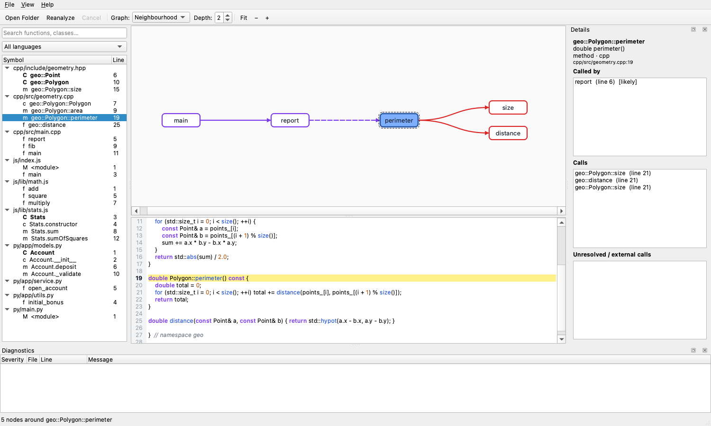

# CodeTrace

**Static analysis, call graphs and (soon) debugging for C++, Python and JavaScript.**
Free, offline, MIT-licensed. *One Core — Multiple Interfaces — Multiple Languages.*



CodeTrace opens a project, finds every function, class, method and import, resolves
who calls whom across files, and shows it as an interactive call graph next to the
source. The same C++20 core powers the Qt desktop app, a command-line tool, and a
JSON-RPC server that IDE extensions talk to.

## Status: v0.1 (MVP)

| Spec item | State |
|---|---|
| C++, Python, JavaScript analysis; automatic language detection | ✅ |
| Functions, classes, methods, imports; call sites | ✅ |
| Cross-file call resolution and file dependencies | ✅ |
| Cyclic dependency detection (files) and recursion groups (functions) | ✅ |
| Cross-language links (pybind11 `m.def("name", &fn)` → Python calls) | ✅ (pybind11 only) |
| Interactive call graph: zoom, pan, search/filter, chain highlighting, click → source | ✅ |
| Background analysis with progress and cancellation; incremental re-analysis | ✅ |
| Never crashes on broken code (fuzzed, ASan/UBSan clean) | ✅ |
| JSON-RPC server for IDE extensions | ✅ (extensions themselves: v0.3) |
| Debugger integration, memory inspector, timeline | planned (v0.4–v0.5) |

The v0.1 acceptance criterion — open a C++/Python/JS project, list functions and the
calls found, see a basic graph and jump to the source line — is covered by the
`Project.AnalyzesMultiLanguageSampleProject` test and the desktop smoke test.

## Analyzer backends

Each language has a **precise** backend and an always-available **heuristic** fallback.
The best available backend is chosen automatically. If a precise backend fails on a file,
that file falls back to the heuristic backend.

| Language | Precise backend | Fallback |
|---|---|---|
| C++ | libclang (LLVM/Clang C API). Results are merged with the heuristic pass when headers can't be resolved | token-based structural analyzer |
| Python | CPython `ast` module in a helper process (code is parsed, never executed) | indentation-based analyzer (also used for files with syntax errors) |
| JavaScript | Tree-sitter (`tree-sitter-javascript`) | token-based structural analyzer |

`codetrace backends` lists which backends are active. Environment overrides:
`CODETRACE_CPP_BACKEND=heuristic`, `CODETRACE_JS_BACKEND=heuristic`,
`CODETRACE_PYTHON_BACKEND=heuristic`, and `CODETRACE_PYTHON=/path/to/python3`.

## Downloads

Get the latest packages from [GitHub Releases](https://github.com/FIRSTXGG/CodeTrace/releases/latest).

| Platform | Package | Launch |
| --- | --- | --- |
| Windows x64 | `CodeTrace-windows-x64.zip` | Extract the ZIP and open `CodeTrace.exe`. |
| Linux x86-64 | `CodeTrace-linux-x86_64.tar.gz` | Extract the archive and run `./CodeTrace` from the extracted folder. |
| macOS 26 or later, Apple Silicon | `CodeTrace-macos-arm64.zip` | Extract the ZIP on macOS and open `CodeTrace.app`. |

The Linux desktop package requires X11 or XWayland. See the package's
`README.txt` for dependencies. The macOS app has an ad hoc signature.

The [Release workflow](.github/workflows/release.yml) can build new packages
from source in GitHub Actions.

## Building

Requirements: CMake ≥ 3.21 and a C++20 compiler (GCC 11+, Clang 14+, MSVC 2022).
Optional dependencies:
- **Qt 6.2+** (Widgets, Concurrent) for the desktop app.
- **libclang** for precise C++ analysis.
- **python3** at runtime for precise Python analysis.

```bash
cmake -S . -B build -DCMAKE_BUILD_TYPE=Release -DCMAKE_PREFIX_PATH=/path/to/Qt/6.x/<platform>
cmake --build build --parallel
ctest --test-dir build --output-on-failure
```

| Option | Default | Meaning |
|---|---|---|
| `CODETRACE_BUILD_DESKTOP` | ON | Qt desktop app (skipped with a warning if Qt is not found) |
| `CODETRACE_BUILD_CLI` | ON | `codetrace` CLI / JSON-RPC server |
| `CODETRACE_BUILD_TESTS` | ON | GoogleTest suite |
| `CODETRACE_WITH_LIBCLANG` | ON | Use libclang if found (`LIBCLANG_ROOT` / `LLVM_ROOT` hints) |
| `CODETRACE_WITH_TREE_SITTER` | ON | Build Tree-sitter + JS grammar |
| `CODETRACE_FETCH_DEPS` | ON | Download GoogleTest / Tree-sitter sources at configure time |

**Offline builds:** pass `-DCODETRACE_FETCH_DEPS=OFF` and either point
`TREE_SITTER_SOURCE_DIR` / `TREE_SITTER_JS_SOURCE_DIR` at local checkouts or let
JavaScript use the heuristic backend. GoogleTest is then taken from `find_package(GTest)`.
Running CodeTrace never needs the network.

libclang locations that are found automatically:
- Homebrew: `brew install llvm`.
- Debian/Ubuntu: `apt install libclang-18-dev`.
- Windows: the LLVM installer in `C:\Program Files\LLVM`.

## Using it

**Desktop:** `CodeTrace [path] [--select function]`. Use File → Open Folder, then:
- Click a symbol in the tree or a node in the graph to open its source at the right line.
- Double-click a graph node to re-centre the graph on it.
- *Graph* switches between the neighbourhood of the selected function (*Depth* hops) and
  the whole project.
- Wheel or `+`/`−` zooms, drag pans, `0` fits the graph to the view, `Esc` clears highlighting.
- Callers are drawn in purple and callees in red. Dashed edges are cross-file
  resolutions ("likely"); pink edges cross a language boundary.
- Saving a file in another editor re-analyzes only the files that changed.

**CLI:**

```bash
codetrace analyze path/to/project            # functions, their calls, cycles, diagnostics
codetrace analyze path/to/project --json     # full machine-readable report
codetrace analyze path/to/project --dot | dot -Tsvg > calls.svg
codetrace analyze path/to/project --deps     # file dependency graph and cycles
codetrace analyze src -I include -D NDEBUG   # extra C++ include dirs / defines
codetrace serve                              # JSON-RPC server for IDE extensions
```

## Repository layout

```text
core/                 GUI/IDE-independent engine (library codetrace_core)
  analysis/           program model, analyzer API + registry, project scanner, incremental cache
  graph/              call graph + resolution, file dependency graph, Tarjan SCC, layered layout
  diagnostics/        diagnostics model and helpers
  protocol/           JSON, model serialization, JSON-RPC 2.0 service
analyzers/            language analyzers behind one interface (library codetrace_analyzers)
  common/             C-family lexer, process helper
  cpp/ python/ javascript/
apps/
  cli/                codetrace: analyze / serve / backends
  desktop-qt/         Qt 6 application
extensions/           Visual Studio and VS Code clients (v0.3)
tests/                GoogleTest suite + fixtures
docs/                 architecture, protocol, how to add a language
```

More: [Architecture](docs/architecture.md) · [JSON-RPC protocol](docs/protocol.md) ·
[Adding a language](docs/adding-a-language.md)

## Known limitations (v0.1)

- **C++:** precision depends on include paths. CodeTrace adds every directory that
  contains headers, and you can add more with `-I`/`-D`. `compile_commands.json`
  support is planned. Virtual dispatch is resolved to the statically named method only.
- **Python and JavaScript:** calls are resolved by name and scope (same class, then
  same file, then imported files) with no type inference. `obj.method()` is linked only
  when a single project method has that name. Calls with several candidates are listed
  as *ambiguous* instead of guessed.
- **Cross-language:** only pybind11 bindings are recognised so far.
- **Platforms:** tested on macOS. CI is configured for Linux and Windows but has not run yet.

## Roadmap

| Version | Scope |
|---|---|
| v0.1 | Core, three-language analysis, basic Qt GUI ← *this release* |
| v0.2 | Richer interactive graph (path finding, grouping by file/class), dependency views, `compile_commands.json` |
| v0.3 | Visual Studio and VS Code extensions on the JSON-RPC server |
| v0.4 | Debugger integration: LLDB, debugpy, V8 Inspector |
| v0.5 | Memory inspector, execution timeline |
| v1.0 | Optimisation, documentation, stable release |

## License

MIT — see [LICENSE](LICENSE).
